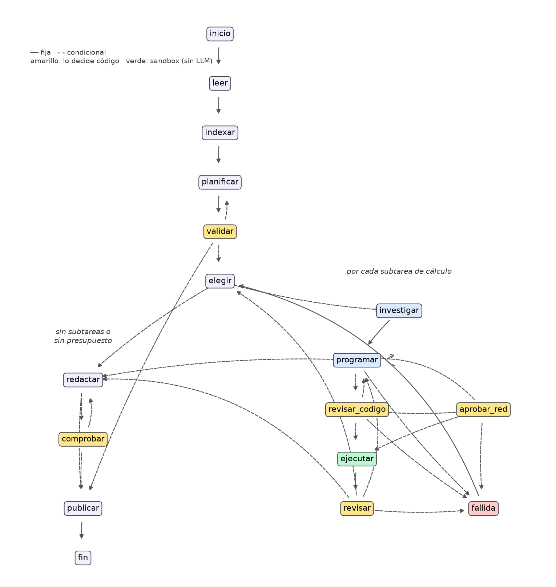
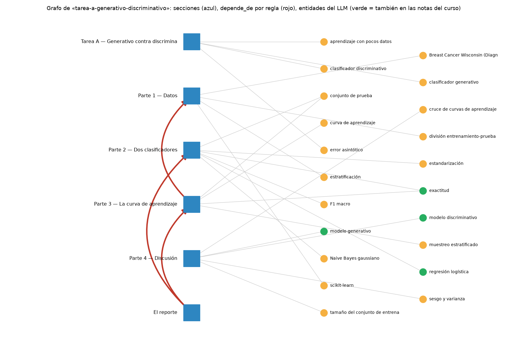

# Taller 03 v2 — Un solver multiagente con GraphRAG

**MMIA 6013 · IA Generativa y Agentes · USFQ**

**Integrantes:** _[completar]_ · **Fecha de las corridas:** 2026-10-05 (Partes 0, 1 y 3) y 2026-10-09 UTC (Parte 2)

| Dato | Valor |
|---|---|
| Ruta del modelo | H200 de la USFQ (vLLM, GlobalProtect), `http://172.28.230.10:12555/v1`, réplica en `:12559` |
| Modelo | `zai-org/GLM-5.3-Flash`, leído de `/v1/models` (queda en el evento `modelo` de cada `traza.jsonl`). El mismo en las Partes 0.a a 2 |
| Embeddings | `bge-m3:latest` (1 024 dimensiones) en el Ollama de `:11434` |
| Costo | 0 (H200) |
| Entorno | Python 3.14.7 con `uv` (los pines del kit, como `numpy==2.5.3`, piden ≥ 3.12), `langgraph==1.2.12`, versiones de `solver-v2/requirements.txt` |
| Código | `mi-solver/`: un archivo por pieza (`lector.py`, `grafo.py`, `agentes.py`, `sandbox.py`, `revisor.py`, `redactor.py`, `llm.py`, `traza.py`) y el orquestador en `solver.py` |

---

## Parte 0 — Tres errores que no dan error

Se corrieron los tres scripts de `solver-v2/parte0/` sin modificarlos. Los tres errores aparecieron.

### 0.a — El solver que no ejecuta
Salida completa en `entregables/parte0/0a_llm_sin_ejecutar.txt`:
```
Medido: NB accuracy 0.9474 · NB F1 macro 0.9429 · LR accuracy 0.9883 · LR F1 macro 0.9875
LLM sin herramientas: zai-org/GLM-5.3-Flash, 2026-10-05, 12451 tokens de salida, 77.17 s, fin=stop
26 cifras con decimales; Procedencia: 0 de 26 cifras salen de una ejecución
¿Dice el reporte que las cifras son estimadas? no
```
El enunciado habla de 30 cifras y aquí salieron 26. No es un cambio de fondo: el modelo escribe un reporte distinto en cada corrida, y lo que importa (ninguna cifra tiene origen y el reporte no avisa que son estimadas) se repitió.

Para ver qué tan lejos quedó, se corrió la curva real con el protocolo de la Tarea A (`0a_curva_medida.py`, que escribe `0a_curva_medida.json`):

| Fracción (n) | NB inventado | NB medido | LR inventada | LR medida |
|---|---|---|---|---|
| 5 % (19) | 0,9123 | 0,9415 | 0,8889 | 0,9298 |
| 10 % (39) | 0,9240 | 0,9474 | 0,9415 | 0,9357 |
| 25 % (99) | 0,9298 | 0,9474 | 0,9649 | 0,9415 |
| 50 % (199) | 0,9357 | 0,9357 | 0,9766 | 0,9766 |
| 100 % (398) | 0,9415 | 0,9474 | 0,9825 | 0,9883 |

**¿Por qué no basta con que estén cerca?** NB 0,9415 contra 0,9474 medido es poco más de medio punto, y a simple vista parece ruido. Pero ninguna de esas cifras salió de una ejecución, así que la cercanía es suerte (el dataset es muy conocido), no medición. Hay un detalle que lo deja claro: 0,9415 es justo la cifra que cita el enunciado del taller, lo que hace pensar en un valor recordado más que calculado.

**¿Qué cifra inventada cambia una conclusión?** La regresión logística al 5 %: 0,8889 inventado contra 0,9298 medido. Con ella el reporte dice que el cruce de Ng y Jordan ocurre «entre 20 y 40 ejemplos». Con lo medido, NB va adelante hasta n = 99 y LR lo pasa recién entre 99 y 199. O sea, la curva inventada confirma la tesis del enunciado, pero en el lugar equivocado, y eso es justamente lo que un lector no tendría cómo notar.

**¿Qué comprobaría un verificador sin conocer las respuestas?** La procedencia: que cada cifra con decimales del entregable aparezca en algo que escribió una ejecución (un JSON, un CSV, la salida de una celda). No hace falta saber cuál es el valor correcto para ver que no hubo ninguna ejecución. Es la comprobación `procedencia` de `evaluar_solver.py` y la regla 5 del solver.

### 0.b — El RAG que pierde la referencia
```
RAG plano (TF-IDF, k=2): Parte 4 (0.293), Parte 3 (0.243) → ✗ datos ✗ proporción ✗ prueba intocable
+ un salto: Parte 3 —depende_de→ Parte 1                  → ✓ datos ✓ proporción ✓ prueba intocable
Las aristas que el regex encontró en todo el enunciado:  Parte 3 → Parte 1 · El reporte → Parte 2, Parte 3
RAG plano: 0 de 3 hechos. Con el salto: 3 de 3.
```
**Es un fallo de la búsqueda** porque ningún modelo intervino todavía: el contexto que se le entregaría ya no trae los datos. La Parte 1 no se parece a la pregunta («¿con qué datos…?»), así que por similitud nunca aparece. **Con el primer contexto, un LLM** inventaría la partición (algún 80/20 sin semilla, quizá otro dataset) o, en el mejor caso, preguntaría. Es el mismo problema de la 0.a, pero esta vez causado por la búsqueda. **La conexión se saca con una regla** porque «Parte 1» está escrito tal cual en el texto: un regex la encuentra siempre, igual en cada corrida y sin costo. Pedírsela al LLM agrega una fuente de error y algo no reproducible para un dato que ya está ahí.

### 0.c — Terminar sin error no es acertar
```
stdout: Exactitud: 1.000
1) Evaluador ingenuo: APROBADO  (returncode=0, resultados.json=sí)
2) estática  — se predice sobre lo mismo que se ajustó: ['X']
   plausible — métricas ≥ 0,999 en un problema con ruido: ['accuracy=1.0']
   → RECHAZADO
```
**La fuga que la revisión del código no ve** es un `StandardScaler().fit(X)` con todos los datos antes de partir. El `fit` es sobre `X` y el `predict` sobre `X_test`, que es otra variable, así que la regla «misma variable en fit y predict» no salta. La media y la desviación del test ya entraron al escalador, y como la exactitud que resulta es creíble (no un 1,000), la revisión de plausibilidad tampoco salta. Por eso el revisor del solver tiene además una regla específica para esto (`fuga_escala`, en `revisor.py`). **Dejar la decisión final a un LLM es aceptable** porque las revisiones con código van antes y a ellas no se las puede convencer: filtran lo que es falso de forma mecánica (código de salida, JSON, NaN, fit y predict sobre lo mismo, métricas imposibles). Al LLM solo le llega lo que ya pasó ese filtro, así que su error queda limitado a juicios del tipo «¿esto responde a la subtarea?».

---

## Parte 1 — El solver base

### Arquitectura

Ocho roles y un orquestador. Cada rol vive en su archivo y el orquestador es un `StateGraph` de LangGraph 1.2.12.

| Rol | Archivo | Qué hace | Qué revisa el código |
|---|---|---|---|
| Lector | `lector.py` | PDF → texto por página; secciones por tamaño de letra; tablas con `find_tables`, pasadas a Markdown | ligaduras (NFKC), palabras cortadas con guion, palabras pegadas, páginas sin texto (PDF escaneado → aviso) |
| Indexador (GraphRAG) | `grafo.py` | nodos = secciones; `depende_de` por regex; encima, entidades del LLM sobre el enunciado y las 83 notas del curso (en caché) | regla 2 |
| Planificador | `agentes.py` | subtareas con tipo, secciones, dependencias y figura, más la especificación del entregable | regla 1 (`validar_plan`) |
| Investigador | `agentes.investigar` | preámbulo, sección literal, sus dependencias (siguiendo `depende_de`), sección de entrega y notas del curso con entidades en común; cada fragmento con su cita | que vayan la sección y sus dependencias |
| Programador | `agentes.programar` | un script por subtarea de cálculo, que escribe `resultados.json` | el filtro del sandbox |
| Ejecutor | `sandbox.ejecutar` | corre el script, sin LLM | regla 3 |
| Revisor | `revisor.py` | comprobaciones con código y, solo si pasan, el LLM | regla 4 |
| Redactor | `redactor.py` | `.md`; `.pdf` con PyMuPDF (achica la letra antes de pedir recortes); `.ipynb` ejecutado dentro del sandbox | regla 5, secciones y extensión |



*Figura 1. El orquestador. Las aristas salen de `Solver()._grafo().get_graph()` (`parte1/diagrama_orquestador.py`, que también deja el Mermaid en `orquestador.mmd`); solo las posiciones están puestas a mano. 17 nodos y 32 aristas.*

El recorrido es: leer → indexar → planificar ⇄ validar → por cada subtarea de cálculo [investigar → programar → revisar_codigo → (aprobar_red) → ejecutar → revisar, y de vuelta a programar hasta aprobar o llegar a 3 intentos] → redactar ⇄ comprobar → publicar. Se pasa a redactar cuando se acaban las subtareas o el presupuesto. Hay un detalle que no estaba en el diseño inicial y salió de las corridas: el bucle de `programar` sobre sí mismo. El modelo de la H200 razona siempre, y a veces gasta todo `max_tokens` razonando y devuelve una respuesta vacía con `finish_reason=length`. `llm.py` reintenta con más cupo, y si aun así no hay respuesta, eso cuenta como un intento fallido de la subtarea, no como el fin de la corrida.

### Las seis reglas, en el código

Cada una está marcada `# REGLA n` en el código.

| Regla | Dónde | Cómo |
|---|---|---|
| 1. El plan se valida con código | `agentes.validar_plan`, `solver.py` (`n_validar`) | ids únicos, dependencias que existen, sin ciclos (`networkx.find_cycle`), toda sección cubierta salvo la de entrega, tipos válidos. Además, formato, archivo y límites contra lo que el enunciado dice de forma explícita (`especificacion_por_reglas`). Hasta 3 vueltas al planificador con la lista de problemas |
| 2. GraphRAG con base fija | `grafo.py` (regex), `agentes.investigar` | «Parte N», «Sección N», «la pregunta anterior», «las mismas …» → `depende_de`, solo hacia atrás. Las menciones hacia adelante quedan como `referencia_adelante` y no se siguen. Encima van las entidades del LLM, unidas con las de las notas por contención de palabras, peso IDF y un piso de coseno con `bge-m3` |
| 3. Sandbox | `sandbox.py` (`revisar`, `ejecutar`) | revisión AST antes de correr (red, procesos, borrado, `eval`/`exec`, dunders, rutas fuera de la carpeta); entorno mínimo sin variables del usuario; carpeta y `TMPDIR` propios; `start_new_session` + `killpg` al vencer el tiempo; y `sandbox-exec` de macOS, que niega red y escritura fuera de la carpeta aunque la revisión estática se equivoque |
| 4. Resultados fijos, código primero | `sandbox.py` (`resultados.json`), `revisor.revisar_con_codigo` | código de salida, JSON, NaN, figura, `fuga_fit`, `fuga_escala`, plausibilidad. El LLM solo se consulta si todo eso pasa |
| 5. Origen de cada cifra | `redactor.sin_origen` / `comprobar` | la misma lógica de `procedencia` de `evaluar_solver.py`: toda cifra con dos o más decimales tiene que estar en un artefacto de una ejecución o en el enunciado. Si no, vuelve al redactor con la lista |
| 6. Siempre hay traza | `traza.py`, `llm.py`, `solver.py` | JSONL escrito línea por línea desde el primer evento, así que sobrevive a una excepción. Por llamada: agente, modelo, tokens, latencia y error. Por ejecución: código de salida, duración y archivos creados |

Las piezas se probaron sin red antes de conectarlas: `test_solver.py` pasa 20 de 20 pruebas (sandbox, revisor, plan, grafo, redactor y orquestador con un modelo de guion).

### El grafo de la Tarea A



*Figura 2. Grafo de la Tarea A (`parte1/grafo_tarea_a.json`). Secciones en azul; aristas `depende_de` en rojo (Parte 3 → Parte 1, El reporte → Partes 2 y 3); entidades del LLM en naranja y, en verde, las que también aparecen en las notas del curso.*

Las aristas rojas son las mismas que encontró el regex de la 0.b, y no podía ser de otra forma porque salen de una regla. Hubo un hallazgo que se esperaba distinto: con `bge-m3`, el top-k plano también trae la Parte 1 para la pregunta de la 0.b (la 0.b falla con TF-IDF). Así que en la Tarea A el grafo no gana en recuperación. Lo que sí garantiza por construcción es traer el preámbulo y la sección de entrega, que la similitud no asegura. La 2.b mide si eso se nota en el resultado.

### Plan de una tarea
`parte1/pruebas/tarea-A/plan.json`, válido al primer intento:

| Subtarea | Tipo | Sección | Depende de | Figura |
|---|---|---|---|---|
| T1 | cálculo | Parte 1 (datos) | — | no |
| T2 | cálculo | Parte 2 (clasificadores) | T1 | no |
| T3 | cálculo | Parte 3 (curva) | T1 | sí |
| T4 | redacción | Parte 4 (discusión) | T2, T3 | no |
| T5 | redacción | El reporte | T2, T3, T4 | no |

Entregable: `reporte.md`, secciones Introducción, Metodología, Resultados, Discusión y Conclusiones, máximo 1 200 palabras. Lo importante es la dependencia T3 → T1: es la misma arista que el grafo encontró, y por eso el investigador le pasa a la curva la partición de la Parte 1.

### Una corrida en que el revisor rechazó scripts
`parte1/pruebas/tarea-E/traza.jsonl` (Tarea E, notebook). El revisor rechazó dos scripts, uno por cada vía:

- **T2, intento 1, rechazado por código** (`decidio: codigo`): `fuga_fit: se predice sobre lo mismo que se ajustó: ['X_train']`. En este caso la regla se equivocó: predecir sobre `X_train` para medir el error de entrenamiento es legítimo. Se corrigió la regla, y el intento 2 se aprobó.
- **T4, intento 1, rechazado por el LLM** (`decidio: llm`): «La figura no queda visible como salida del notebook: el script fuerza el backend no interactivo con `matplotlib.use("Agg")`…». Este rechazo sí era correcto, y el intento 2 se aprobó.

El primer caso deja una lección: un falso positivo del revisor con código cuesta un intento, no una respuesta equivocada. El error contrario, dejar pasar una fuga, sería más caro.

---

## Parte 2 — Evaluación

### 2.a — El golden set

Archivo: `mi-solver/golden_tareas.json`.

| Tarea | Origen | Entregable | Comprobaciones | Qué pone a prueba |
|---|---|---|---|---|
| A | kit | `reporte.md`, ≤ 1 200 palabras | 8 | una parte que depende de otra (Parte 3 → Parte 1) |
| B | kit | notebook ejecutado | 9 | cifras exactas (entropías, top-p) |
| C | kit | `reporte.pdf`, ≤ 2 páginas | 8 | datos dentro de tablas y límite de páginas |
| D | kit | — | — | **excluida**: el paquete `hackathon3_student/` no vino en el kit |
| E | propia | notebook ejecutado | 8 | **trampa:** elegir `alpha` mirando la prueba |
| F | propia | `reporte.pdf`, **1 página** | 6 | **trampa:** no estandarizar antes de k-means |

_[Pendiente de decisión del grupo: E y F son tareas propias, escritas con el formato del kit, y están marcadas `"provisional": true`. El enunciado pide dos tareas reales de la maestría. Si llegan, se sustituyen. Si no, hay que declararlo aquí.]_

E y F cumplen lo que se pide a cada tarea propia: al menos cinco comprobaciones, de ellas al menos dos de tipo `cifra` con su `verdad_py` (la respuesta se calcula, no se escribe) y una de `procedencia`. Entre todas hay notebooks (B, E), PDF (C, F) y dos trampas.

**Cómo se eligieron las trampas.** Una trampa solo informa si quien cae en ella saca cifras distintas. Antes de escribir los enunciados se midió qué pasa con cada error típico (`parte2/trampas_medidas.py`, con los mismos protocolos del `verdad_py`; salida en `trampas_medidas.json`):

| Tarea | Haciéndolo bien | Cayendo en la trampa | ¿El golden set lo detecta? |
|---|---|---|---|
| E | `alpha` por validación cruzada: 0,3162; R² de prueba 0,5037; RMSE 54,3838 | `alpha` elegido con la prueba: 100; R² 0,5159 | sí, por `alpha` (E04) y RMSE (E06); el R² no basta (ver la validación) |
| F | estandarizando: k = 3; silueta 0,2849; ARI 0,8975 | sin estandarizar: k = 2; silueta 0,6569; ARI 0,3694 | sí |
| F (descartada) | — | elegir k mirando las etiquetas: también k = 3 | no, da lo mismo. Por eso no se usó |

La tercera fila es la que más enseñó: una trampa que parecía obvia (usar las etiquetas para elegir k) no cambia ninguna cifra en este dataset, así que el golden set no tendría cómo verla. Hay además dos detalles de diseño. El RMSE de E06 separa Ridge de la regresión sin regularizar (54,3838 contra 54,4331); el R² de E05, en cambio, no los separa (0,5037 contra 0,5028), y eso tiene una consecuencia que se ve más abajo. Y E prohíbe descargar datos («viene incluido en la librería»), así que un script que intente `fetch_*` activa el freno de red de la Parte 3.

**Validación antes de tener solver.** Para saber si las comprobaciones distinguen, se armaron una solución correcta y una que cae en la trampa para cada tarea propia (`parte2/validacion/construir.py`). Las dos versiones son idénticas salvo la trampa, para que lo que cambie sea solo eso. Después se pasaron por el evaluador del kit sin correr el solver (`--solo-evaluar`, salidas en `resultados_correcta.csv` y `resultados_trampa.csv`):

| | Correcta | Con la trampa | Falla solo con la trampa |
|---|---|---|---|
| E | 7/8 | 5/8 | E04 `alpha`, E06 RMSE |
| F | 6/6 | 4/6 | F04 ARI, F05 silueta |

Las dos trampas se detectan, pero la validación dejó ver dos defectos de diseño en E, y es mejor decirlos que esconderlos. El primero: **E03 falla incluso en la solución correcta**. El evaluador acepta un encabezado si no pasa en más de 40 caracteres al nombre de la sección, y el título que trae el propio enunciado («Parte 2 — Selección de alpha por validación cruzada») se pasa. O sea, se castiga a quien copia el título tal cual, que es justo lo que haría un solver cuidadoso. El segundo: **E05 no atrapa la trampa**. Al comparar con la regresión sin regularizar, como pide la Parte 3, el notebook imprime un R² de prueba de 0,5028, y eso queda dentro de la tolerancia de 0,003 alrededor de la verdad (0,5037). La trampa la atrapan E04 y E06, no E05. _[Pendiente: acortar el título de la Parte 2 en el enunciado de E y bajar la tolerancia de E05 (la diferencia es de 0,0009). Se hace después de la 2.b, para no cambiar el golden set a mitad de la corrida, y se vuelve a evaluar con `--solo-evaluar`.]_

Antes, en un primer intento de esta validación, la figura de E (E07) falló por forzar el backend `Agg` de matplotlib, que no deja la imagen en el notebook. Es el mismo error que después el revisor LLM le marcó al solver en T4.

### 2.b — Solver completo contra la versión sin grafo
_[Pendiente: la evaluación está corriendo (`correr_2b.sh`). Las tablas saldrán de `resultados/{completo,sin_grafo}/` con `tablas_2b.py`, no a mano.]_

### 2.c — Los tres peores casos
_[Pendiente: depende de los CSV de la 2.b. Candidato ya visto en la corrida de prueba de la Tarea A: el planificador pidió estandarizar también para Naive Bayes; la tabla dice NB 0,9357 y la curva 0,9474, y A06 pasa igual porque 0,9474 aparece cerca de «Naive».]_

---

## Parte 3 — Los cuatro frenos

Los cuatro se activaron con `frenos_demo.py`, que usa un modelo de guion (`llm.LLMGuion`): cambian solo las respuestas del LLM, y el orquestador, el sandbox, el revisor y la traza son los mismos de `solver.py`. Cada carpeta de `entregables/parte3/` tiene la `traza.jsonl` de la corrida que activó el freno, y `resumen.json` junta lo que decidió cada una.

**1. Presupuesto de tokens con reserva para el redactor** (`llm.Presupuesto.revisar`, antes de cada llamada). Corrida `1_presupuesto`: 14 000 tokens en total, 4 000 de reserva y 1 200 por llamada. Indexar y planificar gastan 8 400. El programador hace un intento, y el segundo ya no cabe: «programador: 9 600 gastados + ~1 204 estimados > presupuesto menos la reserva del redactor (10 000)». Entonces el solver pasa a redactar, el redactor usa la reserva (es el único agente que puede) y entrega con status `parcial`, con T1 y T2 marcadas `sin_presupuesto`. El costo de cada llamada se estima antes de hacerla, como el tamaño del historial dividido entre 3 caracteres por token, así que es una estimación y no una cuenta exacta.

**2. Máximo de intentos y detector de repetición** (`solver.n_revisar_codigo`, con el hash de los scripts rechazados). Corrida `2_intentos`: el guion hace que el programador devuelva siempre el mismo script con fuga para T1. Se ejecuta una sola vez y el revisor lo rechaza (`fuga_fit`). Los intentos 2 y 3 son idénticos, así que no se vuelven a ejecutar (freno `repeticion`). Al tercero, T1 queda `fallida` (`max_intentos`) y el solver sigue con T2, que se aprueba.

**3. Tiempo máximo del sandbox** (`sandbox.ejecutar`, con `start_new_session` + `killpg`). Corrida `3_tiempo`: un script con un hilo dormido y un `sleep(600)`, con 4 s de límite. Resultado: `timeout=True`, código de salida `None`, 4,01 s. El revisor lo rechaza y el segundo intento se aprueba. Que mueren también los procesos hijos (no solo el script) lo prueba `test_solver.py`: un `sleep 300` lanzado por el script ya no existe después del corte. Esa es la razón de matar el grupo de procesos y no solo el PID.

**4. Confirmación humana antes de usar la red** (`sandbox.revisar` marca `fetch_*`, `load_dataset`, `download=True` y URLs; `solver.n_aprobar_red` llama a la función `aprobar_red`). Hay dos corridas. En `4_red_negada`, sin aprobación (`negar_red`, el valor por defecto), el script no corre y vuelve al programador con el motivo. En `4_red_aprobada`, con una persona que aprueba, corre con la red habilitada en el perfil del sandbox. En consola se usa `preguntar_en_consola`. Este freno no es un rechazo: separa lo peligroso, que se rechaza solo, de lo que necesita a una persona, que se pausa. Y que la red esté realmente bloqueada cuando nadie aprueba no depende de la revisión estática sino de `sandbox-exec` (`test_solver.py`: una conexión a 1.1.1.1 da `PermissionError`).

En las corridas reales apareció un quinto freno que no estaba pedido: `llm_sin_respuesta`. Cuando el modelo agota `max_tokens` razonando y devuelve una respuesta vacía, eso cuenta como un intento fallido de la subtarea en lugar de tumbar la corrida. En la Tarea C pasó con el programador, que agotó 16 000 y 32 000 tokens sin responder antes de hacerlo con 49 000.

---

## Parte 4 — Una mejora
_[Pendiente: se elige después de la 2.b.]_

## Parte 5 — Preguntas

**1. ¿Quién decide que la tarea está resuelta?**

Ninguno de los tres solo. El planificador propone, y `validar_plan` puede devolverle el plan. El revisor aprueba cada script (`n_revisar`, `solver.py:295`), pero antes corren las comprobaciones con código, y el LLM solo ve lo que ya pasó ese filtro. El status lo pone `_informe` (`solver.py:396`), que es código: «completado» solo si el entregable existe, la regla 5 no dejó cifras sin origen, todas las subtareas de cálculo quedaron aprobadas y el presupuesto no se cortó. Si falla algo de eso, sale «parcial». Ojo con lo que eso significa: «completado» dice que el solver cumplió sus propias reglas, no que la respuesta esté bien. En la corrida de prueba de la Tarea A, Naive Bayes salió estandarizado en la tabla (0,9357) y crudo en la curva (0,9474), y aun así salió «completado». Quien decide de verdad si la tarea está resuelta es el golden set, que vive fuera del solver.

**2. ¿Qué agente gasta más tokens? ¿Qué ganó el grafo?**

_[Pendiente: sale de `resumen_solver.csv` de las dos versiones de la 2.b.]_

**3. Uso honesto y daño si el sandbox falla**

Para usarlo de forma honesta hay que declarar que la tarea la resolvió un sistema, con qué modelo y en qué fecha, y adjuntar la traza: ahí queda qué planeó, qué código escribió, qué rechazó el revisor y qué se cambió a mano después. Sin la traza no hay forma de separar el trabajo propio del de la máquina. Sobre el sandbox, conviene ser preciso con lo que protege. El perfil de `sandbox-exec` niega la red y la escritura fuera de la carpeta, pero deja leer todo el disco (`allow default`). Si la revisión AST dejara pasar un script malicioso, no podría borrar ni enviar nada, pero sí podría leer un `.env` o una clave SSH e imprimirla en `stdout.txt`, que queda en la carpeta de la corrida y termina en el repositorio. Y con la red aprobada por una persona (freno 4), esa misma lectura sí podría salir.
