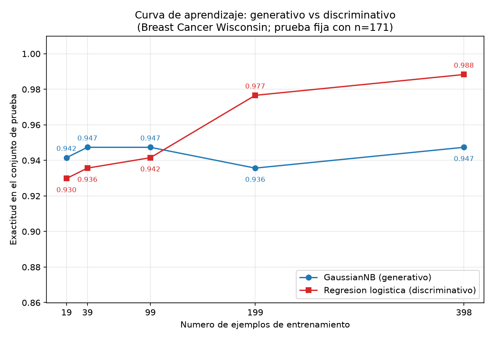

# Tarea A — Generativo contra discriminativo con pocos datos

MMIA 6013 · Reporte de práctica (reporte.md)

## Introducción

Ng y Jordan (2002) predicen que un clasificador generativo alcanza su error asintótico con menos ejemplos de entrenamiento que uno discriminativo, aunque ese error asintótico sea peor. Esta tarea comprueba esa predicción sobre datos reales: el conjunto Breast Cancer Wisconsin (Diagnostic) de scikit-learn, con un Naive Bayes gaussiano como modelo generativo y una regresión logística como modelo discriminativo. La pregunta concreta es si, sobre una misma división de los datos, el generativo gana con pocos ejemplos y el discriminativo lo supera cuando el entrenamiento crece.

## Metodología

Cargué el conjunto con `load_breast_cancer`: 569 ejemplos, 30 atributos numéricos, 212 casos de la clase malignant y 357 de benign (proporciones 0.3726 y 0.6274 del total). Dividí los datos en 70 % entrenamiento y 30 % prueba, estratificando por la clase y con random_state=42; quedaron 398 ejemplos de entrenamiento (148 malignant y 250 benign) y 171 de prueba (64 malignant y 107 benign). Esa división es la única de toda la tarea: el conjunto de prueba no se usa para ajustar nada.

Entrené dos modelos sobre ese mismo entrenamiento: un GaussianNB sin preprocesamiento y una regresión logística con los atributos estandarizados, ajustando el StandardScaler solo con los datos de entrenamiento. Evalué ambos sobre el conjunto de prueba con exactitud y F1 macro.

Para la curva de aprendizaje reentrené los dos modelos con submuestras estratificadas del entrenamiento correspondientes al 5 %, 10 %, 25 %, 50 % y 100 % (random_state=42), es decir, 19, 39, 99, 199 y 398 ejemplos, y evalué cada modelo siempre sobre los mismos 171 ejemplos de prueba. En la curva se reporta solo la exactitud, como pide el enunciado, y la figura se guarda como PNG. El código (Python con scikit-learn) que produce todas las cifras y la figura se entrega en un script aparte, junto con este reporte.

## Resultados

La tabla 1 muestra el desempeño en el conjunto de prueba (171 ejemplos) con el entrenamiento completo (398 ejemplos).

| Modelo | Accuracy | F1 macro | Errores |
|---|---|---|---|
| Naive Bayes gaussiano | 0.9357 | 0.9307 | 11 |
| Regresión logística | 0.9883 | 0.9875 | 2 |

Con el entrenamiento completo, la regresión logística supera al Naive Bayes por 0.0526 de exactitud y 0.0569 de F1 macro.

La tabla 2 y la figura corresponden a la Parte 3: exactitud en prueba según el tamaño del entrenamiento.

| n entrenamiento | Fracción | Acc. GaussianNB | Acc. Reg. logística | Dif. (RL − NB) |
|---|---|---|---|---|
| 19 | 5 % | 0.9415 | 0.9298 | −0.0117 |
| 39 | 10 % | 0.9474 | 0.9357 | −0.0117 |
| 99 | 25 % | 0.9474 | 0.9415 | −0.0058 |
| 199 | 50 % | 0.9357 | 0.9766 | +0.0409 |
| 398 | 100 % | 0.9474 | 0.9883 | +0.0409 |

El Naive Bayes gana con 19, 39 y 99 ejemplos; la regresión logística gana con 199 y 398.

## Discusión

El cruce que predicen Ng y Jordan sí se observa con estas cifras. Con entrenamientos pequeños (19, 39 y 99 ejemplos, es decir 5 %, 10 % y 25 %) el GaussianNB tiene mayor exactitud que la regresión logística: la brecha a favor del generativo es de 0.0117 con 19 y con 39 ejemplos, y de 0.0058 con 99. Entre 99 y 199 ejemplos el orden se invierte: con 199 (50 %) la regresión logística alcanza 0.9766 frente a 0.9357 del Naive Bayes, y con los 398 ejemplos completos llega a 0.9883 frente a 0.9474. El generativo converge pronto y el discriminativo lo rebasa cuando hay datos suficientes, que es justo el patrón del artículo.

La forma de las curvas lo confirma. La exactitud del GaussianNB casi no cambia con el tamaño: se mantiene entre 0.9357 y 0.9474 en los cinco puntos, con un descenso en 199 ejemplos atribuible al ruido de una sola submuestra; con solo 19 ejemplos ya está cerca de su techo. La regresión logística sube de forma casi monótona: 0.9298, 0.9357, 0.9415, 0.9766 y 0.9883. Su error asintótico es menor que el del generativo, como predice la teoría.

En términos de sesgo y varianza, el GaussianNB tiene un sesgo fuerte: asume que los 30 atributos son independientes entre sí dentro de cada clase y que cada uno sigue una gaussiana. Esas suposiciones no se cumplen aquí (atributos como mean radius, mean perimeter y mean area están fuertemente relacionados), así que aunque tuviera datos infinitos no llegaría al error de Bayes; su asíntota queda por debajo, entre 0.9357 y 0.9474 de exactitud en este problema. A cambio, ese modelo estima pocas cantidades (una media y una varianza por atributo y clase, más las probabilidades a priori), tiene baja varianza y con 19 ejemplos ya produce estimaciones estables; por eso gana en los tamaños pequeños. La regresión logística tiene menor sesgo: no impone independencia ni forma de las distribuciones, solo una frontera de decisión lineal. Esa flexibilidad le cuesta varianza cuando hay pocos datos, y por eso pierde con 19 a 99 ejemplos; cuando el entrenamiento crece, su varianza baja y su menor sesgo le permite superar al generativo y seguir mejorando.

Una advertencia honesta: con 171 ejemplos de prueba, una diferencia de 0.0117 equivale a 2 ejemplos bien clasificados, y solo se evaluó una submuestra por tamaño (random_state=42). El cruce entre 99 y 199 ejemplos es claro (la diferencia pasa de −0.0058 a +0.0409), pero las brechas en los puntos pequeños son modestas y podrían variar con otra semilla.

## Conclusiones

Con una única división 70/30 estratificada de Breast Cancer Wisconsin, el experimento reproduce el resultado de Ng y Jordan (2002). El Naive Bayes gaussiano alcanza su mejor desempeño con pocos ejemplos (gana con 19, 39 y 99) y se estabiliza pronto, con exactitudes entre 0.9357 y 0.9474; la regresión logística necesita más datos (gana desde 199 ejemplos) y termina arriba, con 0.9883 de exactitud y 0.9875 de F1 macro, frente a 0.9357 y 0.9307 del generativo con el entrenamiento completo. La lectura práctica es directa: con pocos datos conviene el modelo generativo, porque su sesgo fuerte le da baja varianza; con datos suficientes conviene el discriminativo, porque su sesgo menor le da un techo de error más bajo. Como limitación, solo se usó una submuestra por tamaño y un solo sorteo de la división; repetir el experimento con varias semillas, reportando promedio y desviación de la exactitud, haría el cruce más robusto.
