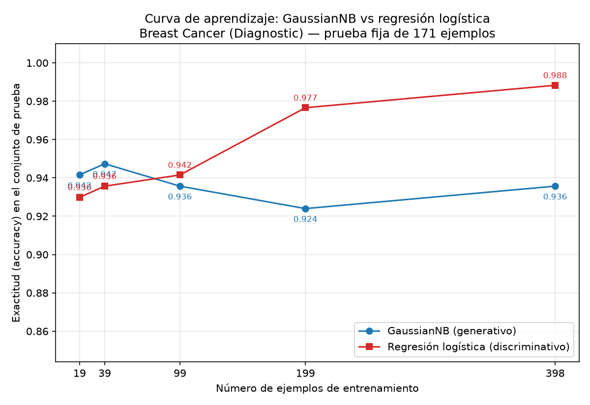

# Generativo contra discriminativo con pocos datos: Breast Cancer Wisconsin (Diagnostic)

## Introducción

Ng y Jordan (2002) mostraron teóricamente que un clasificador generativo alcanza su error asintótico con menos ejemplos de entrenamiento que uno discriminativo, aunque ese error asintótico sea mayor. Esta tarea comprueba esa predicción sobre datos reales comparando un Naive Bayes gaussiano (generativo) con una regresión logística (discriminativa) en el conjunto Breast Cancer Wisconsin (Diagnostic) de scikit-learn, midiendo la exactitud sobre un conjunto de prueba fijo mientras el entrenamiento crece del 5 % al 100 %.

## Metodología

**Datos y división.** El conjunto tiene 569 ejemplos con 30 atributos: 212 de la clase malignant y 357 de benign. Se dividió en 70 % entrenamiento y 30 % prueba, estratificando por la clase y con random_state=42. La división quedó en 398 ejemplos de entrenamiento (148 malignant, 250 benign) y 171 de prueba (64 malignant, 107 benign); las proporciones reales son 0.6995 y 0.3005 por el redondeo de la estratificación. Esta es la única división usada en toda la tarea: el conjunto de prueba no se empleó para ajustar nada.

**Modelos.** Naive Bayes gaussiano con valores por defecto y regresión logística (max_iter=5000, random_state=42) precedida de un StandardScaler ajustado solo con el entrenamiento; la prueba únicamente se transforma.

**Curva de aprendizaje.** Sobre la misma división, se entrenaron ambos modelos con submuestras estratificadas del entrenamiento correspondientes al 5 %, 10 %, 25 %, 50 % y 100 % (random_state=42): 19, 39, 99, 199 y 398 ejemplos (la más pequeña tiene 7 malignant y 12 benign). En cada submuestra el escalador se reajustó solo con ella. Todos los modelos se evaluaron siempre sobre el mismo conjunto de prueba de 171 ejemplos, reportando exactitud y F1 macro.

## Resultados

Con el entrenamiento completo (398 ejemplos), sobre el conjunto de prueba:

| Modelo | Accuracy | F1 macro |
|---|---|---|
| Naive Bayes gaussiano | 0.9357 | 0.9307 |
| Regresión logística | 0.9883 | 0.9875 |

La regresión logística supera al Naive Bayes por 0.0526 de exactitud. En la matriz de confusión, el Naive Bayes clasifica 7 casos malignant como benign (y 4 benign como malignant), mientras que la regresión logística se equivoca en un solo caso de cada clase.

Exactitud en prueba según el tamaño del entrenamiento:

| n entrenamiento | 19 (5 %) | 39 (10 %) | 99 (25 %) | 199 (50 %) | 398 (100 %) |
|---|---|---|---|---|---|
| Naive Bayes gaussiano | 0.9415 | 0.9474 | 0.9357 | 0.9240 | 0.9357 |
| Regresión logística | 0.9298 | 0.9357 | 0.9415 | 0.9766 | 0.9883 |

El Naive Bayes gana con 19 y 39 ejemplos (ventaja de 0.0117 en ambos casos); la regresión logística gana a partir de 99 ejemplos, primero por 0.0058 y luego por 0.0526 con 199 y 398 ejemplos.

## Discusión

El cruce que predicen Ng y Jordan sí se observa. Con muy pocos datos gana el generativo: 0.9415 contra 0.9298 con 19 ejemplos y 0.9474 contra 0.9357 con 39. El cruce ocurre entre 39 y 99 ejemplos: con 99 la regresión logística ya adelanta al Naive Bayes y la brecha crece hasta 0.0526 con el entrenamiento completo (0.9883 contra 0.9357).

Cada curva confirma un extremo de la predicción. El Naive Bayes alcanza su régimen asintótico casi de inmediato: su exactitud se mantiene en un rango estrecho (entre 0.9240 y 0.9474) en todos los tamaños, y su mejor marca (0.9474 con 39 ejemplos) supera incluso a la del entrenamiento completo (0.9357). La regresión logística, en cambio, mejora de forma monótona, de 0.9298 con 19 ejemplos a 0.9883 con 398.

La explicación está en el sesgo y la varianza. El Naive Bayes gaussiano impone supuestos fuertes: los 30 atributos serían independientes dentro de cada clase y cada uno normal. En este conjunto eso es falso (radio, perímetro y área del tumor miden esencialmente lo mismo), así que ese sesgo alto le pone un techo: su error asintótico es mayor. A cambio, solo debe estimar medias y varianzas por atributo y clase, lo que da baja varianza: con 19 ejemplos ya prácticamente convergió. La regresión logística asume mucho menos: solo una frontera de decisión lineal, sin modelar la distribución de los atributos. Ese sesgo menor le permite el mejor desempeño final (0.9883), pero su estimación discriminativa es más sensible al tamaño de muestra: con 19 o 39 ejemplos el ajuste es inestable y rinde peor que el generativo, y necesita cientos de ejemplos para superar el techo del Naive Bayes. Es exactamente el intercambio de Ng y Jordan: el generativo converge rápido hacia un error mayor; el discriminativo, lento hacia uno menor.

Una cautela: con 171 ejemplos de prueba, una diferencia de 0.0117 son muy pocos casos, de modo que el punto exacto del cruce (entre 39 y 99) no es preciso; lo robusto es la tendencia: meseta temprana del generativo y mejora sostenida del discriminativo.

## Conclusiones

1. Con el entrenamiento completo, la regresión logística supera al Naive Bayes gaussiano en prueba: 0.9883 contra 0.9357 de exactitud y 0.9875 contra 0.9307 de F1 macro.
2. Se observa el cruce de Ng y Jordan: con 19 y 39 ejemplos gana el generativo; a partir de 99 gana el discriminativo y la ventaja llega a 0.0526.
3. El patrón es consistente con sesgo y varianza: los supuestos fuertes del generativo le dan convergencia rápida pero un techo de desempeño; el discriminativo, con supuestos más débiles, arranca peor pero alcanza un error final menor.
4. En la práctica: con muestras pequeñas conviene el modelo generativo simple; con datos suficientes, el discriminativo. Además, en este problema médico, la regresión logística reduce los falsos negativos de 7 a 1 en la prueba.
