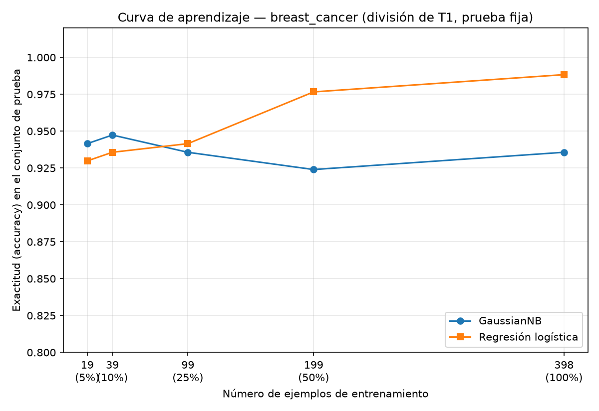

## Introducción

Ng y Jordan (2002) predijeron que un clasificador generativo alcanza su error asintótico con menos ejemplos de entrenamiento que uno discriminativo, aunque ese error final sea peor. Esta tarea comprueba esa predicción con datos reales: comparo un Naive Bayes gaussiano (generativo) contra una regresión logística (discriminativo) sobre el Breast Cancer Wisconsin (Diagnostic), primero con el entrenamiento completo y luego con submuestras del 5 % al 100 %, evaluando siempre sobre el mismo conjunto de prueba.

## Metodología

**Datos y división.** El conjunto tiene 569 ejemplos con 30 atributos y dos clases: 212 malignos y 357 benignos (proporciones 0.3726 y 0.6274). Dividí 70 %/30 % estratificando por la clase con random_state=42: quedaron 398 ejemplos de entrenamiento (148 malignos, 250 benignos) y 171 de prueba (64 malignos, 107 benignos). Esa es la única división de toda la tarea; el conjunto de prueba no se usó para ajustar nada.

**Modelos.** GaussianNB con valores por defecto sobre los atributos originales, y regresión logística con los atributos estandarizados (StandardScaler ajustado solo con el entrenamiento; max_iter=5000 y random_state=42, resto por defecto).

**Evaluación.** Sobre el conjunto de prueba medí exactitud y F1 macro. Para la curva de aprendizaje reentrené ambos modelos con el 5 %, 10 %, 25 %, 50 % y 100 % del entrenamiento (submuestras estratificadas, random_state=42; el escalador se reajustó dentro de cada submuestra) y evalué siempre sobre los mismos 171 ejemplos de prueba. Los tamaños de entrenamiento resultantes fueron 19, 39, 99, 199 y 398 ejemplos, y la división coincide índice por índice con la de la Parte 1.

## Resultados

**Parte 2 — modelos entrenados con los 398 ejemplos, evaluados en el conjunto de prueba:**

| Modelo | Accuracy | F1 macro |
|---|---|---|
| GaussianNB | 0.9474 | 0.9429 |
| Regresión logística | 0.9883 | 0.9875 |

La regresión logística supera a GaussianNB por 0.0409 de exactitud y 0.0446 de F1 macro. En la matriz de confusión, GaussianNB cometió 7 falsos benignos y 2 falsos malignos; la regresión logística, 1 y 1.

**Parte 3 — curva de aprendizaje (exactitud sobre el mismo conjunto de prueba):**

| n entrenamiento | GaussianNB | Regresión logística |
|---|---|---|
| 19 (5 %) | 0.9415 | 0.9298 |
| 39 (10 %) | 0.9474 | 0.9357 |
| 99 (25 %) | 0.9357 | 0.9415 |
| 199 (50 %) | 0.9240 | 0.9766 |
| 398 (100 %) | 0.9357 | 0.9883 |

## Discusión

El cruce que predicen Ng y Jordan sí se observa. Con 19 ejemplos gana GaussianNB (0.9415 contra 0.9298, una ventaja de dos aciertos sobre los 171 de prueba) y con 39 también (0.9474 contra 0.9357). Entre 39 y 99 ejemplos se cruzan las curvas: con 99 la regresión logística ya va arriba (0.9415 contra 0.9357) y mantiene la ventaja con 199 (0.9766 contra 0.9240) y con 398 (0.9883 contra 0.9357).

La forma de cada curva explica el porqué. La de GaussianNB es casi plana: 0.9415, 0.9474, 0.9357, 0.9240 y 0.9357. Ya con 19 ejemplos está cerca de su techo y añadir datos no la mejora; incluso baja un poco. Ese es el comportamiento de un modelo de varianza baja y sesgo alto: el supuesto de que los 30 atributos son independientes dada la clase fija un límite que ningún tamaño de muestra rompe, así que converge rápido a un error asintótico mediocre (su exactitud en esta prueba se mueve entre 0.9240 y 0.9474).

La de la regresión logística sube de forma casi monótona: 0.9298, 0.9357, 0.9415, 0.9766 y 0.9883. Su supuesto es más débil (no modela la distribución conjunta de los atributos, solo la frontera de decisión), así que tiene menos sesgo pero más varianza: con pocos ejemplos paga ese precio y pierde contra Naive Bayes, pero cada lote adicional de datos reduce su error y su techo final es más alto (0.9883 contra 0.9357 con el entrenamiento completo).

En síntesis: con pocas etiquetas conviene el generativo porque converge antes; con suficientes datos conviene el discriminativo porque su error asintótico es menor. Es exactamente el patrón de Ng y Jordan, replicado en este dataset.

## Conclusiones

- Con la división 70/30 fija, la regresión logística ganó la comparación final: accuracy 0.9883 contra 0.9474 y F1 macro 0.9875 contra 0.9429.
- La curva de aprendizaje mostró el cruce predicho: GaussianNB fue mejor con 19 y 39 ejemplos, la regresión logística desde 99 en adelante, y con el entrenamiento completo la exactitud fue de 0.9883 contra 0.9357.
- La lectura en términos de sesgo y varianza es consistente con la teoría: el generativo, de sesgo alto y varianza baja, llega pronto a su meseta; el discriminativo, de menor sesgo y mayor varianza, necesita más datos pero termina más arriba.
- Limitación: solo hay una división de los datos y las diferencias con 19–99 ejemplos equivalen a uno o dos aciertos, así que conviene no sobreinterpretar el punto exacto del cruce; lo robusto es la tendencia de las dos curvas.
